    

- 🚀 Founder @[7Blocks](https://www.7block.in/)
  
- 💻 Building across **SaaS, Decentralized Technologies, AI & Automation**.
    
- 🏆 2× National Hackathon Champion | 🌍 Open-Source Project Admin ([Kepler](https://github.com/7-Blocks/Kepler))
    
- 📫 Reach me at [**krish.khinchi@7block.in**](mailto:krish.khinchi@7block.in)

 

---

# 🎖️ LeetCode Badges

---

# 🎖️ GSSoC`26 Badges

---

# 🏆 GitHub Trophies

---

# 🚀 Featured ships

<table>
  <tr>
    <td width="50%"> <strong>Live:</strong> kepler.7block.in
    <td width="50%"> <strong>Live:</strong> aerotwin-ai.vercel.app</td>
  </tr>
  <tr>
    <td width="50%"> <strong>Live:</strong> attentionnai.vercel.app
    <td width="50%"> <strong>Live:</strong> odooclone.netlify.app</td>
  </tr>
</table>

---

# 📈 Contribution Graph

<picture>
  <source media="(prefers-color-scheme: dark)" srcset="https://raw.githubusercontent.com/krishkhinchi/krishkhinchi/output/pacman-contribution-graph-dark.svg">

  <source media="(prefers-color-scheme: light)" srcset="https://raw.githubusercontent.com/krishkhinchi/krishkhinchi/output/pacman-contribution-graph.svg">
  
  
</picture>

 
 

  

